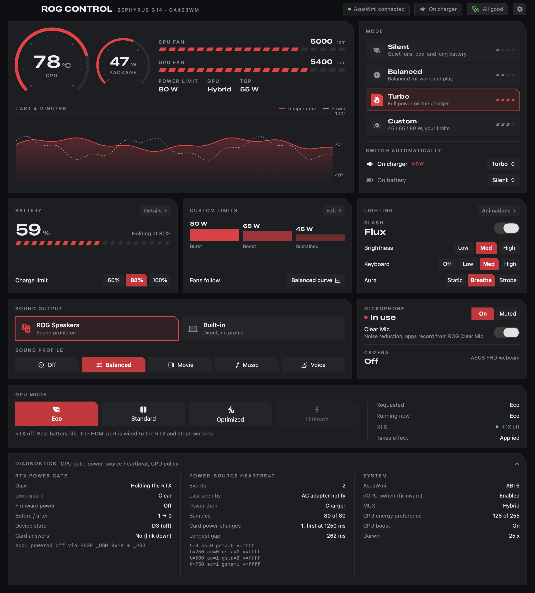
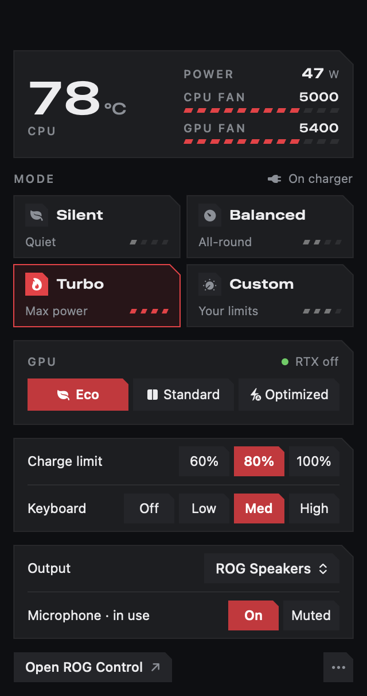

# ROG Control 0.6.0: GPU mode (Eco), StrixDgpuGate 0.2.12, AsusWmi 0.3.1

*Screenshots are offscreen renders with sample values.*

> ## Warning: vibe-coded, one-laptop project
> Almost all of this code was written by an AI (Claude) and tested on **one** ASUS ROG Zephyrus G14 **GA403WM**
> (Ryzen AI 9 HX 370, Radeon 890M, RTX 5060) on macOS 26.7.2 (Darwin 25.6). The kexts run in the macOS kernel and can
> panic or hang the machine. `AsusWmi` writes to the EC and the BIOS (fans, power limits, charge limit).
> `StrixDgpuGate` runs ACPI methods that cut power to the discrete GPU and removes its devices from the PCI bus.
> No warranty. Back up first and keep a boot entry without these kexts.

## What this release is

- The tag is a merge of `80356b5` (StrixDgpuGate 0.2.12, branch `fix/eco-offbus`) and `44ee05c` (AsusWmi 0.3.1, branch
  `fix/fan-curve-index`). It is the only tree whose versions equal the ones that run. `main` was not moved.
- The assets are the binaries that ran on the test machine (boots of 2026-11-25 19:46 and 20:42), copied unchanged.
- Not released: StrixDgpuGate 0.2.13 (the tip of `fix/eco-offbus`). It has never been loaded.

## Highlights

"Verified" means seen working on the GA403WM, with the date. "Daily use" means it runs every day on macOS 26.7.2 and
nobody recorded a separate test of that feature on Tahoe.

| Feature | State on the GA403WM |
|---|---|
| **GPU mode: Eco** powers the RTX 5060 off through `StrixDgpuGate` and takes it off the PCI bus | Verified: powers off since 2026-11-09; off the bus and no 60 s login wait since 2026-11-19. **Sleep / wake in Eco is not tested.** No HDMI in Eco |
| **GPU mode: Standard / Optimized** | Standard is the state without the gate. Optimized (Eco on battery, decided at boot): no test recorded. Every change needs a restart |
| **Diagnostics**: gate state, loop guard, power-source heartbeat, CPU policy | Daily use |
| **Performance modes** Silent / Balanced / Turbo / Custom, switched automatically on charger and battery | Verified 2026-10-12 on macOS 15. Daily use on macOS 26 |
| **Live readings**: CPU temperature, package power, fan speeds, a 4-minute history | Daily use |
| **Custom power limits** (burst, boost, sustained) and **fan curves** | Verified 2026-10-12 on macOS 15. The fan-curve read-back after the AsusWmi 0.3.1 fix is still owed |
| **Battery charge limit** 60 / 80 / 100 % | Verified 2026-10-12 on macOS 15. Daily use on macOS 26 |
| **Slash LED**, **keyboard backlight**, **Aura** | Keyboard light and Slash verified 2026-10-12; Aura released in 0.5.2 (macOS 26.7.1) |
| **Fn / ROG keys** through `rogkeyd`; **Doctor** | Released in 0.5.2 (macOS 26.7.1). Daily use |
| **Sound output**, ROG speaker profile, **Clear Mic** | The controls are in the app; the audio parts behind them are not in this repository or this release (they come from the [GA403WM Hackintosh](https://github.com/thanhnndev/ga403wm-hackintosh) project) |

## What changed since `rogcontrol-v0.5.2` (2026-11-06)

### New

| Item | Status |
|---|---|
| **GPU mode** Eco / Standard / Optimized, stored in NVRAM `strix-gpu-mode`, applied at the next boot (no live switch) | verified: Eco boots since 2026-11-09 |
| `StrixDgpuGate`: claims the RTX before the NVIDIA driver, powers it off through `_DSM 0x1A` + `_PS3` | verified 2026-11-09 13:06 (GSTA 1 to 0, `_PSC` 3, vendor 0xFFFF, no panic) |
| RTX taken off the PCI bus once it is off (0.2.0+): ends the 60 s WindowServer wait on Eco boots | verified 2026-11-19 15:51 with 0.2.1: "Server is starting up" to "Creating FB" 3.8 s (was 63.4 s), login window at T0+14.4 s (was 77 s) |
| Loop guard: one failed Eco boot makes the next boot stand down | guard logic verified by its own evidence properties; see known issues |
| AC-change heartbeat trace (NVRAM `strix-gpu-hb`) | loaded since 2026-11-10; the charger hang it was built for was not reproduced |
| Shutdown trace in NVRAM `strix-gpu-sd` (0.2.9 to 0.2.12) | loaded since 2026-11-23. 0.2.12 wrote `S0:0` on its first boot (clock not set yet); the fix is 0.2.13, not in this release |
| AsusWmi 0.3.0: ABI 6, selectors 6/7 (GPU state, store mode) | loaded since 2026-11-10 |
| RogControl 0.6.0: GPU tile, "Restart required", diagnostics card | installed 2026-11-10; daily use |
| RogControl 0.5.3 (never released on its own): mode names Silent / Balanced / Turbo | part of 0.6.0 |
| AmdCppcPolicy: EPP per profile as asusctl's defaults (Balanced 128 to 191) | installed 2026-11-08 |

### Fixes

| Item | Version | Status |
|---|---|---|
| Fan curves for Turbo and Silent were swapped (firmware index 0 balanced, 1 silent, 2 turbo) | AsusWmi 0.3.1 | **loaded since 2026-11-18, not verified**: the fan-curve read on the machine is still owed |
| A clean shutdown before the 90 s clear tripped the next boot | gate 0.2.4 to 0.2.6 | verified 2026-11-23 |
| Off-bus round cap counted across wakes | gate 0.2.3 | verified 2026-11-19 17:17: off the bus in one round |
| Slow re-check capped, kept out of sleep, stopped at shutdown | gate 0.2.8 to 0.2.12 | loaded since 2026-11-23; Eco holds. 0.2.7 was skipped |

## Known issues

- **Sleep / wake with the RTX off the bus is untested.** `docs/GPU-MODE.md` has a code review only.
- **Plugging the charger in hard-hung an Eco boot once** (2026-11-10 09:14, 8 s after AC came in, no panic). Cause not
  proven, not reproduced.
- A restart on 2026-11-23 13:11 took 3 min 51 s between WillRestart and reset. Cause unknown.
- The loop guard tripped on boots that did not hang (2026-11-16; the 0.2.3 shutdown case). 0.2.4+ fixes the known cause.
  A forced power-off, a panic or a power loss before the boot finished still trips it, by design.
- **HDMI is wired to the RTX: no HDMI in Eco.** The mode is decided at boot.
- Optimized does not switch on an AC change; the app shows "restart required".
- Only macOS 26 (Darwin 25.x): the gate does nothing on other major versions.
- Everything is ad-hoc signed, not notarised.
- CI does not package StrixDgpuGate; the assets here were attached by hand.

## Install

- `RogControl-0.6.0.dmg`: open it and drag ROG Control into Applications.
- Kexts: copy into `EFI/OC/Kexts`, add under `Kernel > Add`, reboot. For `StrixDgpuGate` read
  [docs/GPU-MODE.md](https://github.com/thanhnndev/rog-control-macos/blob/rogcontrol-v0.6.0/docs/GPU-MODE.md) first.
  Off switches: boot-arg `-strixgate_off`; keep the card on the bus with `sudo nvram strix-gpu-keepbus=1`.
- `rogkeyd-1.2.app.zip`: unchanged since 0.5.2; see [docs/FN-HOTKEYS.md](https://github.com/thanhnndev/rog-control-macos/blob/rogcontrol-v0.6.0/docs/FN-HOTKEYS.md).
- `AmdCppcPolicy.zip`: see [docs/CPU-POWER.md](https://github.com/thanhnndev/rog-control-macos/blob/rogcontrol-v0.6.0/docs/CPU-POWER.md).

## Roadmap

1. Install and check gate 0.2.13 (the shutdown stamp).
2. Sleep / wake and charger-plug tests with the RTX off the bus.
3. Read the fan curves with AsusWmi 0.3.1 in Turbo and Silent.
4. Merge pull requests 16 and 17 and this release into `main`; add StrixDgpuGate to CI packaging.
5. HDMI without a restart: a feasibility study, not started.

## Assets

All binaries are the ones that ran, byte for byte. Kexts are zipped with `ditto -c -k --keepParent`; the DMG was packed
on 2026-11-25 with `scripts/build-dmg.sh` around the installed app (the app inside is unchanged and its signature verifies).

| File | Version | Source | UUID of the binary inside | SHA-256 of the file |
|---|---|---|---|---|
| `StrixDgpuGate-0.2.12.kext.zip` | 0.2.12 | `80356b5`; a rebuild of this tag gives identical loaded sections | `7AD92287-3A47-3405-8071-0C6CD6C4A8C1` | `0fb816ebfdb58a77af4f1d65a78ab6fe59564a8dcb9466e1baae52bfcefdc6c8` |
| `AsusWmi-0.3.1.kext.zip` | 0.3.1 | `44ee05c`; a rebuild of this tag gives identical loaded sections | `42393DEB-8FB7-30D7-806B-CB360A619FEF` | `6dfbb47476054932cd70d8f50396251648d44263d06f9ad54b149d40c4cdc260` |
| `AmdCppc-0.2.1.kext.zip` | 0.2.1 | built by GitHub Actions on or before 2026-11-03 (the source has not changed since 2026-10-12); the exact run is not recorded | `2EBD4419-8AB4-3795-BE16-9557A0E3BAFC` | `0c057d2b5e8870fb8e193dbde92e6e532f16fa364aa2b161804cf297331fa208` |
| `RogControl-0.6.0.dmg` | 0.6.0 (build 12) | `01e0adb` (built 2026-11-10 10:04; a rebuild of this tag gives identical sections) | `CD6D0DF2-2CD2-3788-9D99-CF45E49CAEFC` | `4343db923f9f526836586eed3f32676ef1bb3d32c48047d1b0af9cd7f142af52` |
| `RogControl-0.6.0.dmg.sha256` | n/a | written by `scripts/build-dmg.sh` | n/a | n/a |
| `rogkeyd-1.2.app.zip` | 1.2 (build 3) | `8b02133` line, built 2026-11-05; `macos/RogKeys` is unchanged since 0.5.2 | `EFBCC204-9553-37E8-9351-78F3E02889CA` | `843afee6af1524cb45f7fa135ebb9e4a6266c99a95b5ee2b37c8bbc0d3ab263a` |
| `AmdCppcPolicy.zip` | n/a | `2190f16` (built 2026-11-08 12:04) | `06E60AFE-7AF5-323C-94CC-80D2A1FCB855` | `2d433df0fbda5ab8eedc95491b34cc41cc644d49751e7e9efa5b37fb4ad5b0f1` |
| `LICENSE` | n/a | this tag | n/a | `18ea8e404a91378ceb54eaa1514626b83d2c25a0aa6f6da3dbd2d4264e869304` |
| `SHA256SUMS.txt` | n/a | the zips, the DMG and `LICENSE` | n/a | n/a |

SHA-256 of the binaries inside:

| Binary | SHA-256 |
|---|---|
| `StrixDgpuGate` | `d113ec41edcfd0a69393aea9158d855645945a8242ea6137f6ef6acd60d2176f` |
| `AsusWmi` | `0ef9020439be12cb5cf1b35d2a13d21f839f0fef8afe630b0e16a72b842abff7` |
| `AmdCppc` | `bd879adf39098b02d4960c8330dae5a4d45840e072ab743598d3f3bbea984e27` |
| `RogControl` | `1d547ec4240733c02e0d6f5784198d7409e3b1fb802e92189515fb3f79569138` |
| `rogkeyd` | `765a527e1dd533a1933fa7f66839cd492501e06788dd27f7f4bc547ee9374737` |
| `AmdCppcPolicy` | `a28e4d09a9781d9a2a34671278c904461acc0feab81eebf5d73e8be33071c7eb` |

The kexts' symbol tables contain the build paths of the machine that built them.

## Licences

- Everything here is under the Clear BSD License (`LICENSE`). A binary redistribution must reproduce the copyright
  notice, the conditions and the disclaimer: keep `LICENSE` next to the binaries.
- No firmware and no third-party code is inside the binaries. MacKernelSDK is a build-time dependency only.

## Credits

Nothing in this release is copied from the projects below. They are what made it possible.

- [asusctl / rog-control-center](https://github.com/opengamingcollective/asusctl) and [asus-linux.org](https://asus-linux.org),
  by Luke Jones and the asus-linux contributors (MPL-2.0): the feature set and its organisation, the EPP defaults per profile.
- Linux `asus-wmi` (Corentin Chary and contributors) and `asus-armoury` (Luke Jones): WMI method and device ids, the
  calling convention, profile values and the GA403WM power-limit ranges. Interface values only.
- Linux `k10temp` / `amd_nb`: the Tctl register address used by `AmdCppc`. Interface values only.
- [G-Helper](https://github.com/seerge/g-helper): the HID report sequences for the keyboard light and the Slash display,
  the mode names, a UX reference.
- [asusctltray](https://github.com/Baldomo/asusctltray): a UX reference.
- [acidanthera/MacKernelSDK](https://github.com/acidanthera/MacKernelSDK) (build time) and
  [OpenCore](https://github.com/acidanthera/OpenCorePkg) (the boot loader that injects the kexts).
- [NullMoth Systems' NVIDIA driver for macOS](https://github.com/nullmoth/nvidia-macos-driver): the RTX driver that
  `StrixDgpuGate` steps in front of in Eco. Not part of this release.
- [Claude](https://claude.com/claude-code) (Anthropic) wrote most of the code and documentation, directed and tested by thanhnndev.

Details: [NOTICE.md](https://github.com/thanhnndev/rog-control-macos/blob/rogcontrol-v0.6.0/NOTICE.md).
