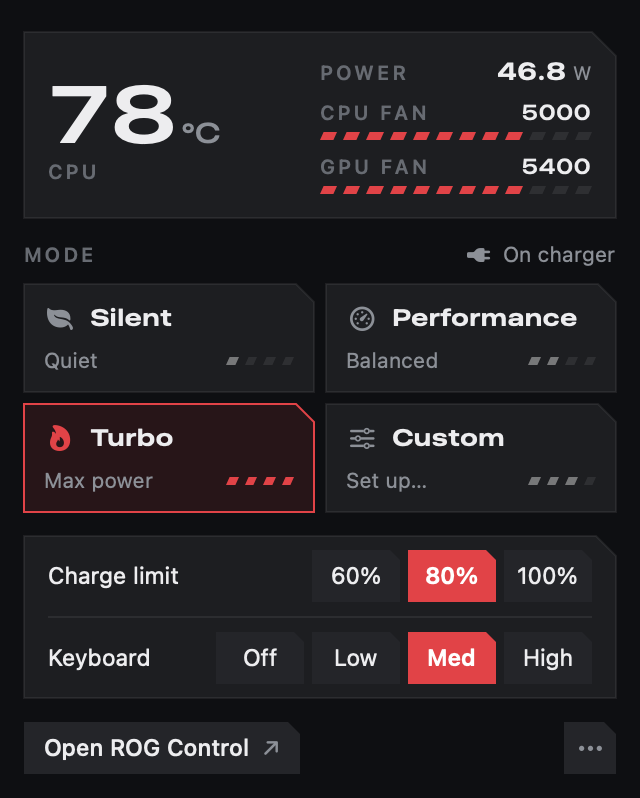
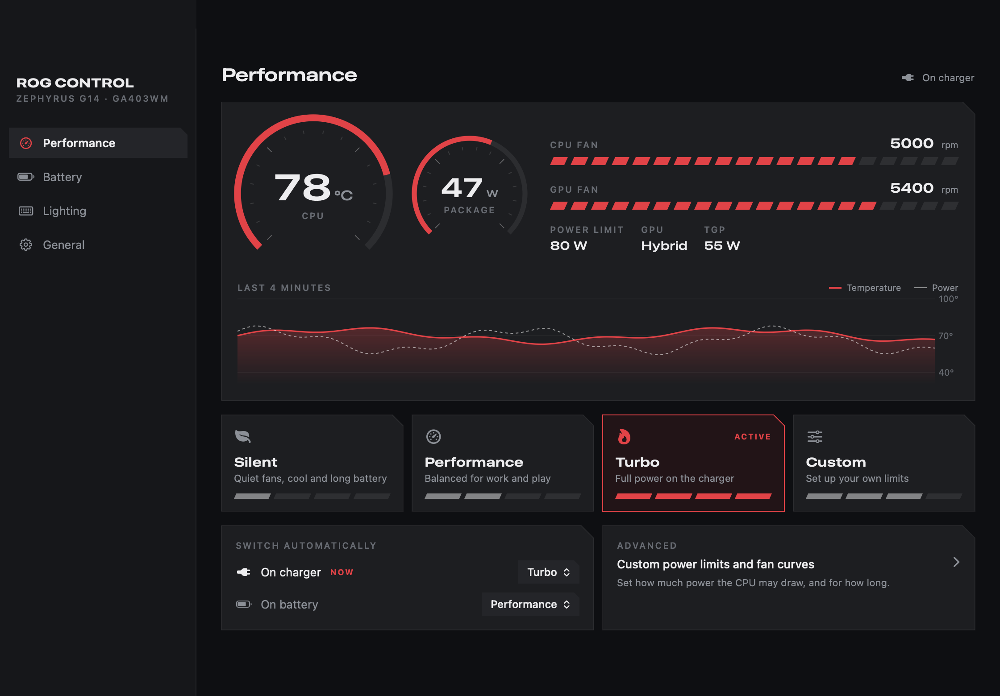
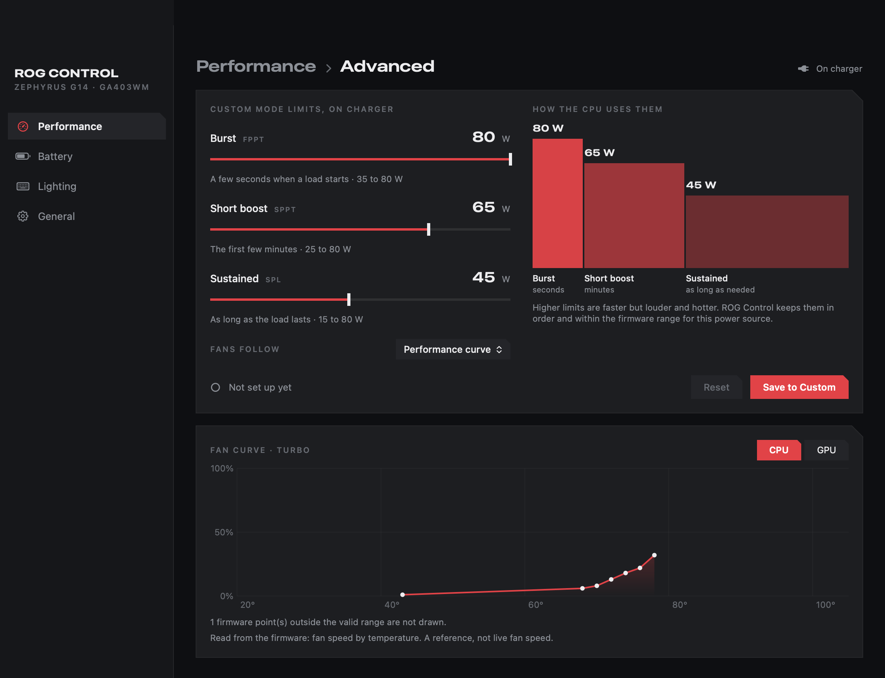

# rog-control-macos

ROG Control Center for macOS on the **ASUS ROG Zephyrus G14 (GA403WM)**: performance profiles, CPU power limits, fan
curves and speeds, battery charge limit, keyboard light and Slash lighting from a menu bar app, backed by two kexts.

macOS has no driver for ASUS's ACPI WMI device, so the embedded controller keeps the profile and power limits it booted
with and nothing on macOS can change them. This repo is the macOS counterpart of Linux `asus-wmi` / `asus-armoury`
(the kext) and of `asusd` / `rog-control-center` from [asusctl](https://github.com/opengamingcollective/asusctl) (the app).
No asusctl code is included; see [NOTICE.md](NOTICE.md).

> Part of the [GA403WM Hackintosh](https://github.com/thanhnndev/ga403wm-hackintosh) project (OpenCore EFI and index of the
> parts). Sibling repo for the radio chip: [mt7925-macos](https://github.com/thanhnndev/mt7925-macos) (Wi-Fi and Bluetooth).

**Vibe-coded, kernel code.** The kexts run in the kernel. Read the source before you install anything, and keep a way to
boot without them (OpenCore picker, remove the kext from `config.plist`).

## What is in it

| Part | Where | What it does |
|---|---|---|
| `AsusWmi.kext` | `kexts/AsusWmi` | Matches the ACPI `ATKD` device (`PNP0C14`, `_UID "ATK"`) and calls its WMI methods like `asus-wmi`: platform profile, PPT limits (range-checked for AC or battery), fan curves, fan speeds, charge limit, keyboard light (N-KEY HID report), Slash lighting, ATKD hotkeys |
| `AmdCppc.kext` | `kexts/AmdCppc` | Ryzen AI 9 HX 370: Tctl and package power (`debug.amdcppc.sensors`), per-CPU clocks (`debug.amdcppc.freq`), CPPC boost and EPP controls |
| `RogControl.app` | `macos/RogControl` | SwiftUI menu bar app plus a window (Overview, Performance, Lighting, Battery & Display, Settings). Talks to AsusWmi through its user client, no sudo |
| `AmdCppcPolicy` | `macos/AmdCppcPolicy` | Root LaunchDaemon that applies the CPPC policy after boot and wake |

## Status

Reference unit: GA403WM, Ryzen AI 9 HX 370. Owner-confirmed on 2026-10-12, when the machine ran macOS 15 (24H32): profiles
(Silent / Performance / Turbo), Manual power limits, fan curves, fan speeds, charge limit (60 / 80 / 100 %), per-power-source
settings, keyboard light, Slash lighting, the RogControl app. macOS 26 (Tahoe) has **not** been checked. Other ASUS models
are untested; the power-limit ranges are the GA403WM's. Per-feature detail and the open items are in
[docs/ASUSCTL-MACOS.md](docs/ASUSCTL-MACOS.md).

## Screenshots

<p align="center">&nbsp;&nbsp;</p>
<p align="center"></p>

## Releases

| Release | Contents |
|---|---|
| [rog-v1.0](https://github.com/thanhnndev/rog-control-macos/releases/tag/rog-v1.0) | `AsusWmi.kext`, `AmdCppc.kext`, `AmdCppcPolicy`, `RogControl.app`, `SHA256SUMS.txt`. Binaries copied unchanged from `kext-v1.1` of the EFI repo; same checksums |

## Build

On macOS with the Xcode command line tools (the kexts cannot be built on Linux):

```bash
bash scripts/build.sh                      # build/AsusWmi.kext, build/AmdCppc.kext
bash scripts/build-amdcppc-policy.sh       # build/AmdCppcPolicy
bash scripts/test-rogcontrol.sh            # fan-curve decoding, never writes hardware
bash scripts/build-rogcontrol.sh           # build/RogControl.app
bash scripts/build-rogcontrol.sh --install # copy to /Applications, start at login
```

CI builds the same on `macos-14` and uploads the zips (ad-hoc signed; nothing is notarized).

## Install the kexts

OpenCore loads what `config.plist` lists, by path. Copy the kext into `EFI/OC/Kexts`, add it under `Kernel > Add`, reboot.
`scripts/macos-install-kext.sh AsusWmi` does the copy and keeps the old kext in `EFI/OC/Kexts-backup`; `--undo` puts it
back. It does not edit `config.plist`. AmdCppc and its policy daemon: [docs/CPU-POWER.md](docs/CPU-POWER.md).

## Docs

* [docs/ASUSCTL-MACOS.md](docs/ASUSCTL-MACOS.md): feature map, WMI device ids, ABI, measurements.
* [docs/rog-control-design.md](docs/rog-control-design.md): menu bar and window design decisions, fan-curve drawing rules.
* [docs/CPU-POWER.md](docs/CPU-POWER.md): AmdCppc audit and the CPPC policy.
* [docs/FN-HOTKEYS.md](docs/FN-HOTKEYS.md) (branch `dev/fn-hotkeys`), [docs/AUDIO-ROG.md](docs/AUDIO-ROG.md) (branch `dev/audio`).

## Branches

* `main`: the shipped menu bar app and the two kexts.
* `dev/fn-hotkeys`: mapping of the GA403WM Fn and M keys. Not merged.
* `dev/audio`: a from-scratch rewrite of the app with an audio page, the RogAudio HAL plug-in and mic chain. Speakers were
  still silent in audible tests when the branch was last touched. Not merged.

The history of these files was split out of `thanhnndev/ga403wm-hackintosh` with `git filter-repo`; commits keep their
original dates and authors.

## License

[Clear BSD](LICENSE). Credits and third-party notes: [NOTICE.md](NOTICE.md).
