# rog-control-macos

<p align="center">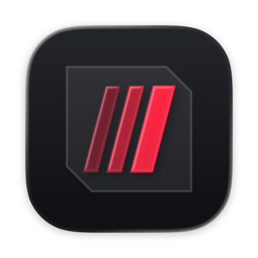</p>

<p align="center">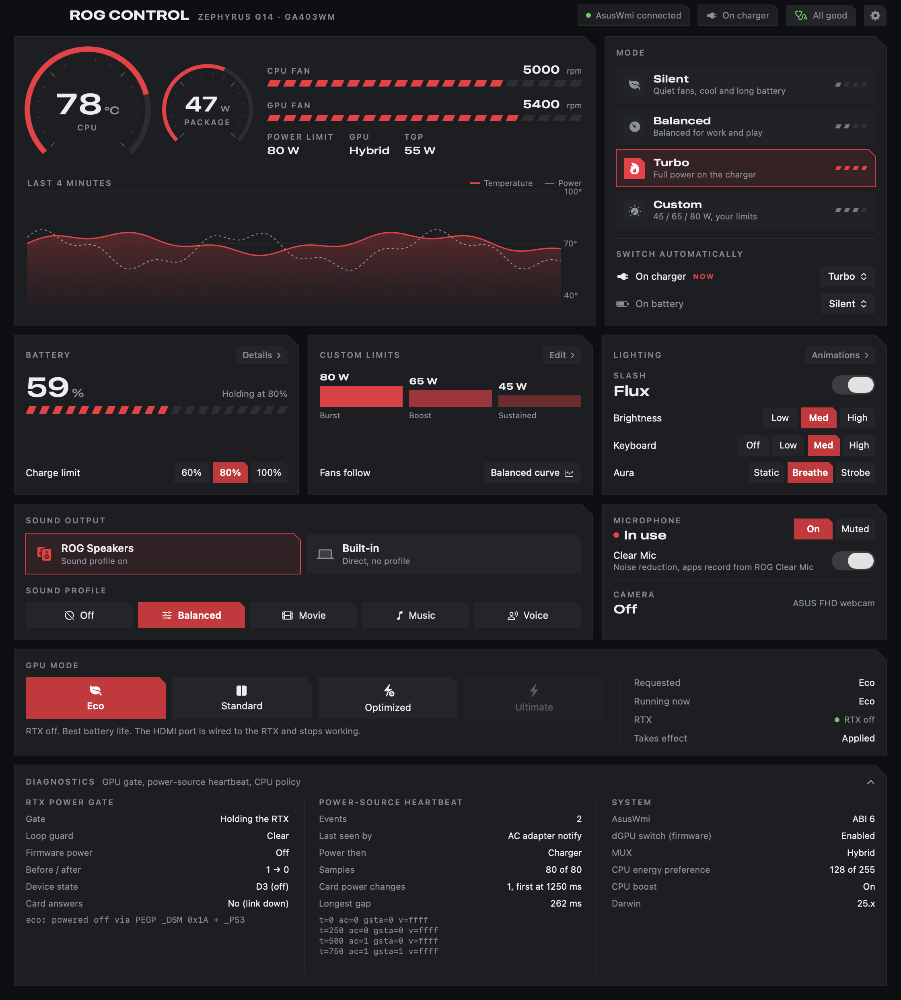</p>
<p align="center">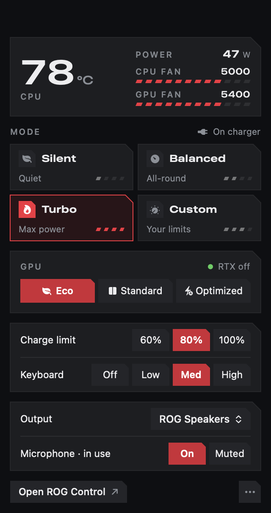</p>
<p align="center"><em>ROG Control 0.6.0: cửa sổ đầy đủ và bảng trên thanh menu. Ảnh render offscreen với số liệu mẫu.</em></p>

ROG Control Center cho macOS trên **ASUS ROG Zephyrus G14 (GA403WM)**: chế độ hiệu năng, giới hạn công suất CPU, đường cong
và tốc độ quạt, giới hạn sạc pin, chế độ GPU (Eco tắt RTX 5060), đèn bàn phím và đèn Slash, từ một app trên thanh menu, chạy trên ba kext
(`AsusWmi`, `AmdCppc`, `StrixDgpuGate`).

macOS không có driver cho thiết bị ACPI WMI của ASUS, nên bộ điều khiển nhúng (EC) giữ nguyên profile và giới hạn công suất
lúc khởi động và macOS không đổi được chúng. Repo này là phần tương đương trên macOS của `asus-wmi` / `asus-armoury` của Linux
(kext) và của `asusd` / `rog-control-center` trong [asusctl](https://github.com/opengamingcollective/asusctl) (app). Không có
mã asusctl nào ở đây; xem [NOTICE.md](NOTICE.md).

> Là một phần của dự án [GA403WM Hackintosh](https://github.com/thanhnndev/ga403wm-hackintosh) (EFI OpenCore và mục lục các
> phần). Repo anh em cho chip không dây: [mt7925-macos](https://github.com/thanhnndev/mt7925-macos) (Wi-Fi và Bluetooth).

**Code vibe, chạy trong kernel.** Kext chạy trong kernel. Đọc mã trước khi cài, và luôn giữ cách khởi động không có chúng
(menu OpenCore, bỏ kext khỏi `config.plist`).

## Điểm nổi bật

"Đã kiểm chứng" = đã thấy chạy trên GA403WM, có ngày. "Dùng hằng ngày" = chạy mỗi ngày trên macOS 26.7.2, chưa ai ghi lại
một bài test riêng cho tính năng đó trên Tahoe.

| Tính năng | Trạng thái trên GA403WM |
|---|---|
| **Chế độ hiệu năng** Silent / Balanced / Turbo / Custom, tự đổi khi cắm sạc và khi chạy pin | Đã kiểm chứng 2026-10-12 trên macOS 15. Dùng hằng ngày trên macOS 26 |
| **Số đo trực tiếp**: nhiệt độ CPU, công suất gói, tốc độ hai quạt, biểu đồ 4 phút | Dùng hằng ngày trên macOS 26 |
| **Giới hạn công suất tùy chỉnh** và **đường cong quạt** | Đã kiểm chứng 2026-10-12 trên macOS 15. `AsusWmi` 0.3.1 sửa lỗi đường cong Turbo / Silent bị tráo: đã nạp từ 2026-11-18, **chưa đọc lại để kiểm chứng trên máy** |
| **Giới hạn sạc pin** 60 / 80 / 100 % | Đã kiểm chứng 2026-10-12 trên macOS 15. Dùng hằng ngày trên macOS 26 |
| **Chế độ GPU: Eco** tắt RTX 5060 qua `StrixDgpuGate` và gỡ nó khỏi bus PCI | Đã kiểm chứng: tắt nguồn từ 2026-11-09; khỏi bus, hết chờ 60 s lúc đăng nhập từ 2026-11-19. **Ngủ / thức trong Eco chưa test.** Không có HDMI trong Eco |
| **Chế độ GPU: Standard / Optimized** | Standard là trạng thái không có gate. Optimized chưa có test. Đổi chế độ cần khởi động lại |
| **Chẩn đoán**: trạng thái gate, loop guard, heartbeat nguồn điện, chính sách CPU | Dùng hằng ngày |
| **Đèn Slash**, **đèn bàn phím**, **Aura** | Đèn bàn phím và Slash kiểm chứng 2026-10-12; Aura phát hành ở 0.5.2 (macOS 26.7.1) |
| **Phím Fn / ROG** qua `rogkeyd`; trang **Doctor** | Phát hành ở 0.5.2 (macOS 26.7.1). Dùng hằng ngày |
| **Âm thanh**, profile loa ROG, **Clear Mic** | Điều khiển có trong app; phần âm thanh phía sau (`SimpleHDA`, `rogaudiod`, plug-in RogAudio) **không nằm trong repo hay release này**, chúng thuộc dự án [GA403WM Hackintosh](https://github.com/thanhnndev/ga403wm-hackintosh) |

## Gồm những gì

| Phần | Ở đâu | Làm gì |
|---|---|---|
| `AsusWmi.kext` | `kexts/AsusWmi` | Khớp thiết bị ACPI `ATKD` (`PNP0C14`, `_UID "ATK"`) và gọi các hàm WMI như `asus-wmi`: profile, giới hạn PPT (kiểm tra theo nguồn AC hoặc pin), đường cong quạt, tốc độ quạt, giới hạn sạc, đèn bàn phím và Aura (báo cáo HID của N-KEY), đèn Slash, các phím Fn do rogkeyd chuyển sang (`kAsusUcKey`, ABI 5) |
| `AmdCppc.kext` | `kexts/AmdCppc` | Ryzen AI 9 HX 370: Tctl và công suất package (`debug.amdcppc.sensors`), xung nhịp từng CPU (`debug.amdcppc.freq`), điều khiển CPPC boost và EPP |
| `RogControl.app` | `macos/RogControl` | App SwiftUI trên thanh menu kèm cửa sổ: chế độ, số đo trực tiếp, pin, giới hạn Custom, đèn, âm thanh, micro và camera, cùng Doctor kiểm tra toàn bộ hệ thống. Nói chuyện với AsusWmi qua user client, không cần sudo. Mỗi người dùng chỉ chạy một bản |
| `rogkeyd.app` | `macos/RogKeys` | LaunchAgent đọc phím Fn của N-KEY (báo cáo vendor 0x5A, macOS bỏ qua) rồi chuyển cho AsusWmi; tự xử lý tắt mic, chế độ máy bay, Fn+F9 và M4. Cần quyền Input Monitoring (và Accessibility cho Fn+F9) |
| `AmdCppcPolicy` | `macos/AmdCppcPolicy` | LaunchDaemon chạy root, áp chính sách CPPC sau khi khởi động và thức dậy |

## Trạng thái

Máy chuẩn: GA403WM, Ryzen AI 9 HX 370, RTX 5060, macOS 26.7.2 (2026-11-25). Đang chạy hằng ngày: AsusWmi 0.3.1,
StrixDgpuGate 0.2.12, AmdCppc 0.2.1, RogControl 0.6.0, rogkeyd 1.2. Chủ máy đã xác nhận từng tính năng ngày 2026-10-12 trên
macOS 15 (profile, giới hạn công suất, đường cong quạt, tốc độ quạt, giới hạn sạc, đèn bàn phím, đèn Slash). Trên macOS 26:
chế độ Eco (tắt RTX và gỡ khỏi bus PCI) đã kiểm chứng từ 2026-11-09 / 2026-11-19; **chưa** thử sleep / wake ở chế độ Eco;
chưa đọc lại đường cong quạt sau bản sửa AsusWmi 0.3.1. Phần âm thanh trong app cần các thành phần âm thanh của dự án
[GA403WM Hackintosh](https://github.com/thanhnndev/ga403wm-hackintosh), không nằm trong repo này. Các model ASUS khác chưa thử.
Chi tiết: [docs/ASUSCTL-MACOS.md](docs/ASUSCTL-MACOS.md), [docs/GPU-MODE.md](docs/GPU-MODE.md).

## Ảnh chụp

<p align="center"></p>
<p align="center"><em>Một màn hình: số đo trực tiếp và chế độ ở trên, pin, giới hạn Custom và đèn ở dưới. Phần cài đặt mở bằng dialog.</em></p>

<p align="center"></p>
<p align="center"><em>Panel trên thanh menu</em></p>

<p align="center">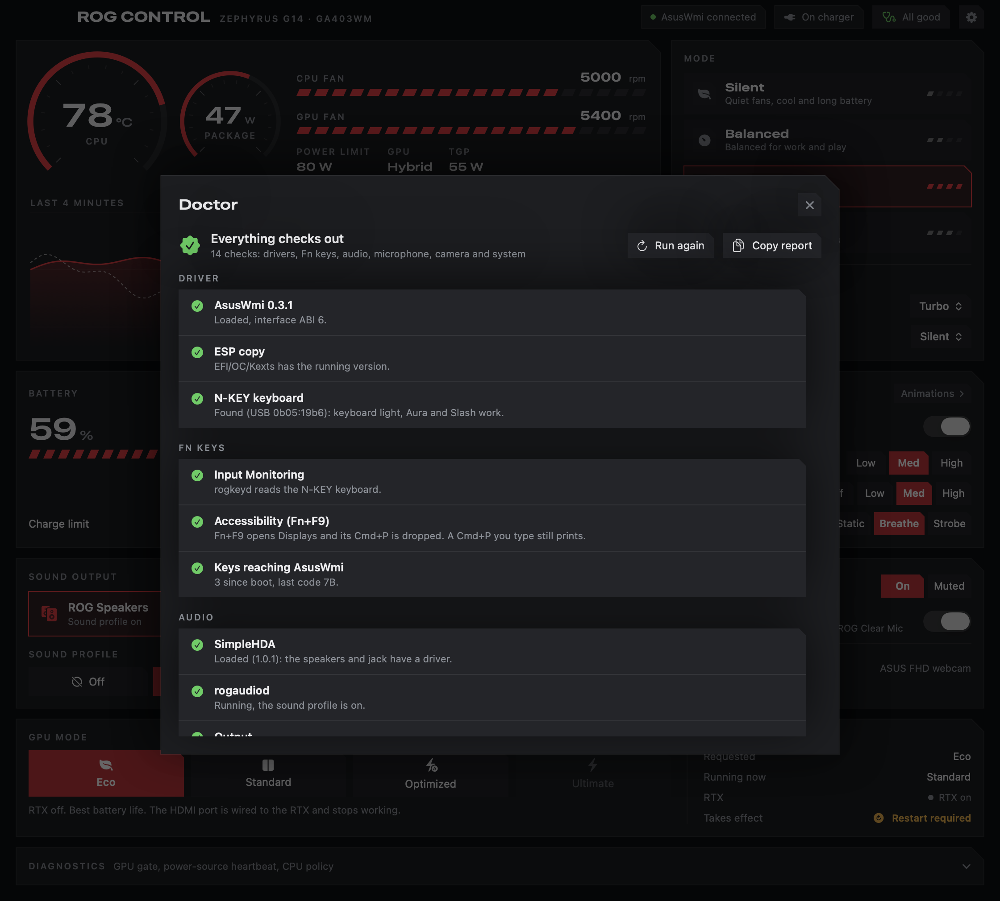&nbsp;&nbsp;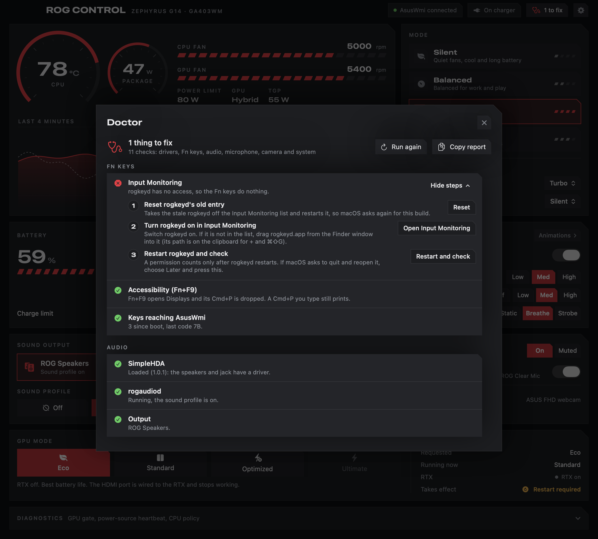</p>
<p align="center"><em>Doctor: mọi thành phần trong một danh sách, và các bước sửa khi thiếu quyền</em></p>

<p align="center">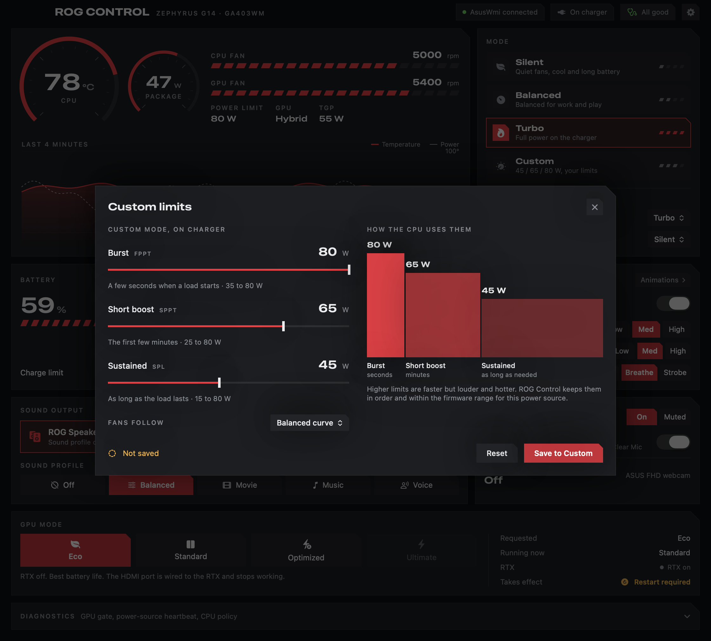&nbsp;&nbsp;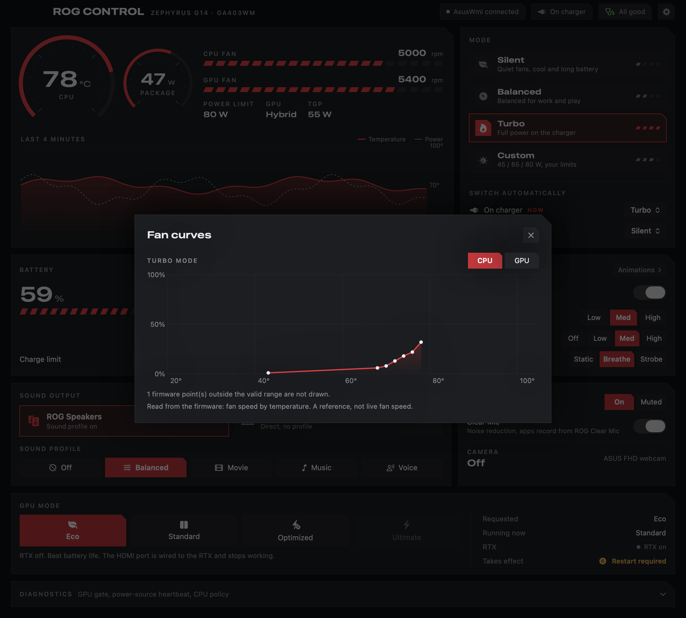</p>
<p align="center"><em>Dialog giới hạn Custom (burst, short boost, sustained bằng lời dễ hiểu) và đường cong quạt của firmware</em></p>

<p align="center">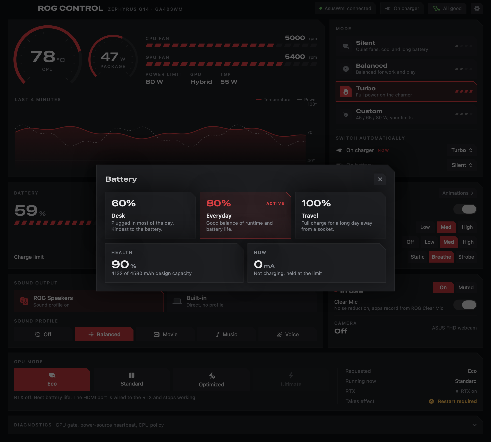&nbsp;&nbsp;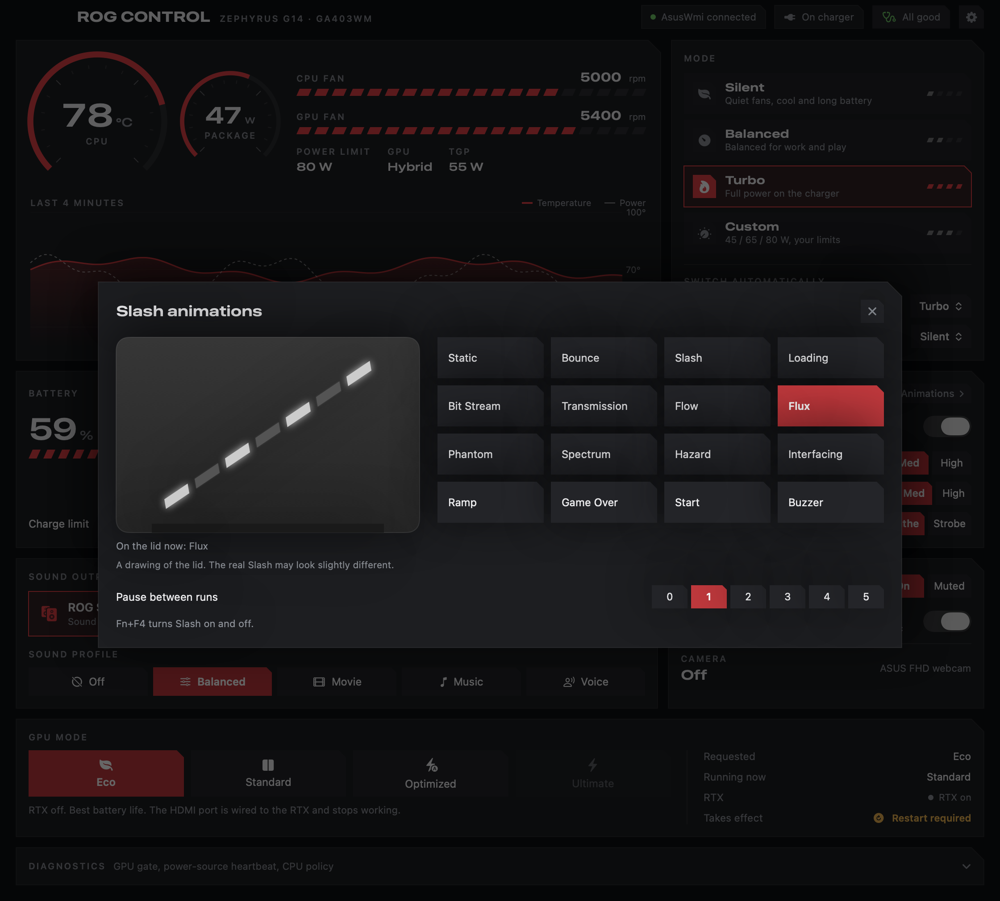</p>
<p align="center"><em>Dialog pin (mức giới hạn sạc, độ chai) và hiệu ứng Slash với mô phỏng mặt lưng G14</em></p>

<p align="center">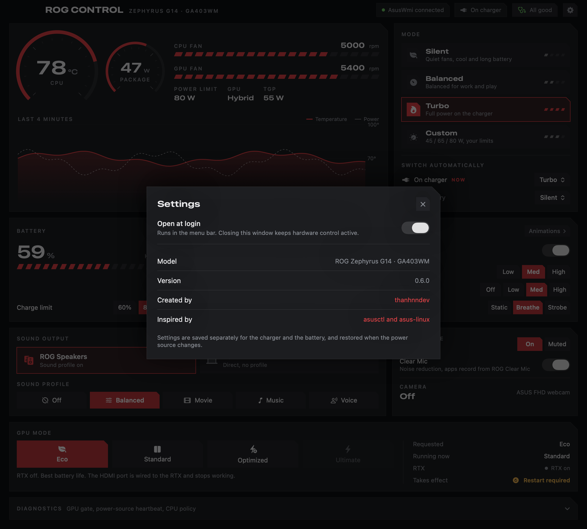&nbsp;&nbsp;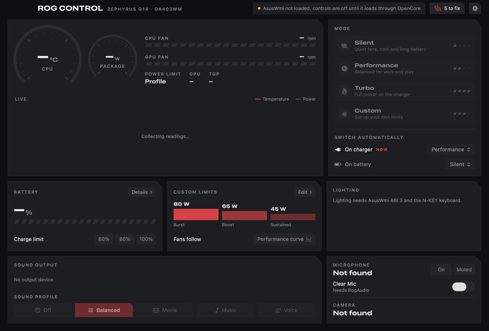</p>
<p align="center"><em>Settings, và cửa sổ khi AsusWmi chưa được nạp</em></p>

<p align="center">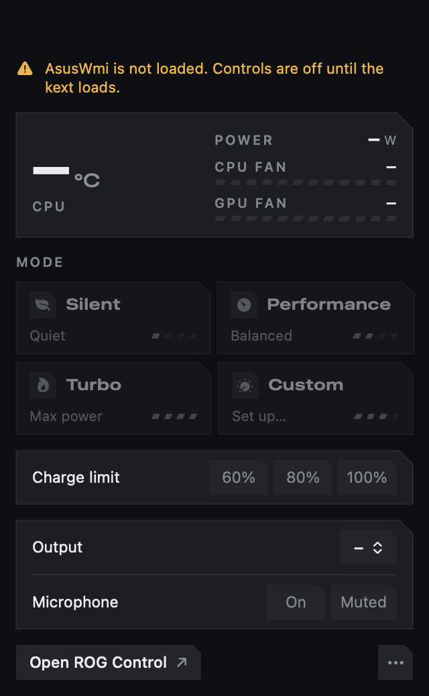</p>
<p align="center"><em>Panel khi AsusWmi chưa được nạp: tắt điều khiển, không hiện số đoán</em></p>

<p align="center">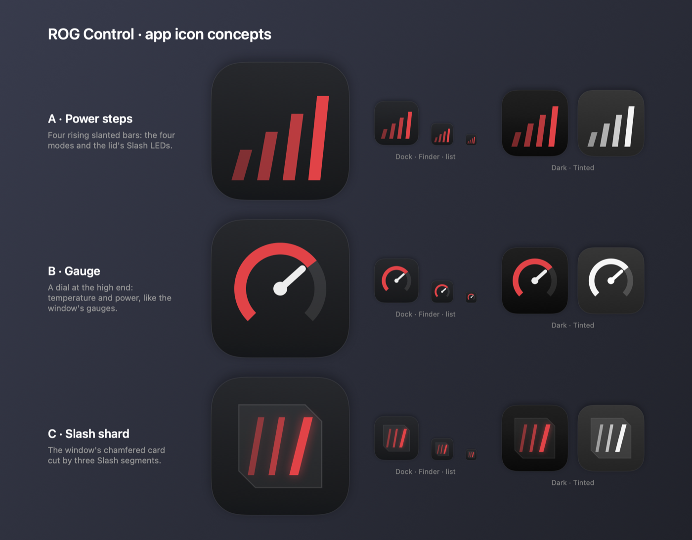</p>
<p align="center"><em>Các phương án icon; chọn C (Slash shard). Ảnh chụp là bản render offscreen với dữ liệu mẫu.</em></p>

## Release

| Release | Nội dung |
|---|---|
| [rogcontrol-v0.5.2](https://github.com/thanhnndev/rog-control-macos/releases/tag/rogcontrol-v0.5.2) | `RogControl-0.5.2.dmg`: Doctor (kiểm tra và hướng dẫn sửa), điều khiển Aura, hàng âm thanh thẳng lưới, mỗi người dùng một bản. `AsusWmi-0.2.2.kext.zip` (phím Fn, Aura, sửa panic Fn+F7/F8; ABI 5) và `rogkeyd-1.2.app.zip` (đọc phím Fn); xem [docs/FN-HOTKEYS.md](docs/FN-HOTKEYS.md) |
| [rogcontrol-v0.4.0](https://github.com/thanhnndev/rog-control-macos/releases/tag/rogcontrol-v0.4.0) | `RogControl-0.4.0.dmg`: đầu ra âm thanh, profile âm thanh, micro, Clear Mic và camera |
| [rogcontrol-v0.3.3](https://github.com/thanhnndev/rog-control-macos/releases/tag/rogcontrol-v0.3.3) | `RogControl-0.3.3.dmg`: cửa sổ một màn hình với dialog, gọn không thừa khoảng trống, icon thanh menu theo kiểu badge của app, số nhiệt độ và công suất ổn định hơn; mở DMG rồi kéo vào Applications. Kext giữ nguyên ở `rog-v1.0` |
| [rog-v1.0](https://github.com/thanhnndev/rog-control-macos/releases/tag/rog-v1.0) | `AsusWmi.kext`, `AmdCppc.kext`, `AmdCppcPolicy`, `RogControl.app`, `SHA256SUMS.txt`. Binary chép nguyên từ `kext-v1.1` của repo EFI; cùng checksum |

## Build

Trên macOS có Xcode command line tools (không build kext được trên Linux):

```bash
bash scripts/build.sh                      # build/AsusWmi.kext, build/AmdCppc.kext
bash scripts/build-amdcppc-policy.sh       # build/AmdCppcPolicy
bash scripts/test-rogcontrol.sh            # test giải mã đường cong quạt, không ghi phần cứng
bash scripts/build-rogcontrol.sh           # build/RogControl.app
bash scripts/build-rogcontrol.sh --install # chép vào /Applications, chạy khi đăng nhập
bash scripts/build-rogkeys.sh --install    # LaunchAgent rogkeyd (phím Fn); sau đó cấp Input Monitoring
bash scripts/build-dmg.sh                  # build/RogControl-<version>.dmg, kéo thả vào Applications
```

CI build tương tự trên `macos-15` và tải lên các file zip (ký ad-hoc, không notarize).

## Cài kext

OpenCore chỉ nạp những gì `config.plist` liệt kê, theo đường dẫn. Chép kext vào `EFI/OC/Kexts`, thêm vào `Kernel > Add`, khởi
động lại. `scripts/macos-install-kext.sh AsusWmi` chép giúp và giữ kext cũ trong `EFI/OC/Kexts-backup`; `--undo` trả lại. Script
không sửa `config.plist`. AmdCppc và daemon chính sách: [docs/CPU-POWER.md](docs/CPU-POWER.md).

## Tài liệu

* [docs/ASUSCTL-MACOS.md](docs/ASUSCTL-MACOS.md): bản đồ tính năng, id thiết bị WMI, ABI, số đo.
* [docs/rog-control-design.md](docs/rog-control-design.md): quyết định thiết kế thanh menu và cửa sổ, quy tắc vẽ đường cong quạt.
* [docs/CPU-POWER.md](docs/CPU-POWER.md): kiểm tra AmdCppc và chính sách CPPC.
* [docs/FN-HOTKEYS.md](docs/FN-HOTKEYS.md): bảng phím Fn, rogkeyd, và lý do không thay driver bàn phím.
* [docs/AUDIO-ROG.md](docs/AUDIO-ROG.md) (nhánh `dev/audio`).

## Nhánh

* `main`: release 0.6.0 (app, rogkeyd, AsusWmi 0.3.1, AmdCppc, StrixDgpuGate 0.2.12), gộp từ `fix/eco-offbus` và
  `fix/fan-curve-index`, đã gồm PR 16 và 17. StrixDgpuGate 0.2.13 (chưa từng nạp) vẫn nằm ở `fix/eco-offbus`.
* `dev/fn-hotkeys`: cách làm phím Fn cũ qua ATKD WMI, vốn không bao giờ kích hoạt trên máy này. Đã được rogkeyd thay thế; không gộp.
* `dev/audio`: viết lại app từ đầu có trang âm thanh, plug-in HAL RogAudio và chuỗi mic. Lần cuối động tới nhánh này loa vẫn
  chưa nghe được trong test có người nghe. Chưa gộp.

Lịch sử các file này được tách từ `thanhnndev/ga403wm-hackintosh` bằng `git filter-repo`; commit giữ nguyên ngày và tác giả.

## Các repo liên quan

Tất cả thuộc cùng một dự án: macOS trên một máy ASUS ROG Zephyrus G14 **GA403WM**.

| Repo | Là gì | Release mới nhất |
|---|---|---|
| [ga403wm-hackintosh](https://github.com/thanhnndev/ga403wm-hackintosh) | Repo chính: EFI OpenCore, ACPI, ghi chú cài đặt, tình trạng và roadmap, các kext phụ | [v2 (macOS 26 Tahoe)](https://github.com/thanhnndev/ga403wm-hackintosh/releases/tag/v2) |
| [mt7925-macos](https://github.com/thanhnndev/mt7925-macos) | Wi-Fi (`itlmt7925`, `itlmt7925Native`) và Bluetooth (`MtkBtFw`, `BtLeDlFix`) cho MediaTek MT7925 | Wi-Fi [v2.0-beta.1](https://github.com/thanhnndev/mt7925-macos/releases/tag/v2.0-beta.1), Bluetooth [bt-v1.1](https://github.com/thanhnndev/mt7925-macos/releases/tag/bt-v1.1) |
| [rog-control-macos](https://github.com/thanhnndev/rog-control-macos) | App RogControl, `AsusWmi`, `AmdCppc`, `rogkeyd`, `StrixDgpuGate` | [rogcontrol-v0.6.0](https://github.com/thanhnndev/rog-control-macos/releases/tag/rogcontrol-v0.6.0) |
| [nvidia-macos-driver](https://github.com/thanhnndev/nvidia-macos-driver) (fork của [nullmoth/nvidia-macos-driver](https://github.com/nullmoth/nvidia-macos-driver)) | Driver màn hình và Metal cho Radeon 890M của máy này (`NMXGPU` và Metal plugin), giấy phép PolyForm Noncommercial | tag mã nguồn [ga403wm-890m-out50](https://github.com/thanhnndev/nvidia-macos-driver/releases/tag/ga403wm-890m-out50), [ga403wm-890m-plugin-a6cec1b](https://github.com/thanhnndev/nvidia-macos-driver/releases/tag/ga403wm-890m-plugin-a6cec1b) |
| [ryzen-hypervisor.framework](https://github.com/thanhnndev/ryzen-hypervisor.framework) (fork của [OverlordDev/ryzen-hypervisor.framework](https://github.com/OverlordDev/ryzen-hypervisor.framework)) | Hypervisor AMD-V cho Docker và Android emulator trên Ryzen, kèm các bản sửa cho máy này | tag mã nguồn [v0.7.24-ga403wm](https://github.com/thanhnndev/ryzen-hypervisor.framework/releases/tag/v0.7.24-ga403wm) |
| [strix-890m-macos](https://github.com/thanhnndev/strix-890m-macos) | Nghiên cứu Radeon 890M trước đây. Đã được driver ở trên thay thế | chưa có |

## Ghi công

Không có gì trong repo này được chép từ các dự án dưới đây. Nhờ chúng mà repo này làm được.

| Dự án | Đóng góp |
|---|---|
| [asusctl / rog-control-center](https://github.com/opengamingcollective/asusctl) và [asus-linux.org](https://asus-linux.org), Luke Jones và cộng sự (MPL-2.0) | Bộ tính năng và cách tổ chức: platform profile, giới hạn PPT, giới hạn sạc, giới hạn theo từng máy, EPP mặc định theo profile |
| Linux `asus-wmi` (Corentin Chary và cộng sự) và `asus-armoury` (Luke Jones) | Mã method và device WMI, quy ước DSTS / DEVS, giá trị profile và dải giới hạn công suất của GA403WM. Chỉ giá trị giao diện |
| Linux `k10temp` / `amd_nb` | Địa chỉ SMN của Tctl dùng trong `AmdCppc`. Chỉ giá trị giao diện |
| [G-Helper](https://github.com/seerge/g-helper) | Chuỗi báo cáo HID cho đèn bàn phím và màn Slash, tên chế độ, tham khảo UX |
| [asusctltray](https://github.com/Baldomo/asusctltray) | Tham khảo UX |
| [acidanthera/MacKernelSDK](https://github.com/acidanthera/MacKernelSDK) | Header và thư viện kernel lúc build; không phân phối lại |
| [OpenCore](https://github.com/acidanthera/OpenCorePkg) (acidanthera) | Boot loader nạp các kext |
| [Driver NVIDIA cho macOS của NullMoth Systems](https://github.com/nullmoth/nvidia-macos-driver) | Driver RTX mà `StrixDgpuGate` chặn trước trong chế độ Eco; không thuộc repo này |
| [Claude](https://claude.com/claude-code) (Anthropic) | Viết phần lớn code và tài liệu, do thanhnndev chỉ đạo và test |

## Giấy phép

[Clear BSD](LICENSE). Ghi công và ghi chú bên thứ ba: [NOTICE.md](NOTICE.md).
