# rog-control-macos

<p align="center"></p>

ROG Control Center cho macOS trên **ASUS ROG Zephyrus G14 (GA403WM)**: chế độ hiệu năng, giới hạn công suất CPU, đường cong
và tốc độ quạt, giới hạn sạc pin, đèn bàn phím và đèn Slash, từ một app trên thanh menu, chạy trên hai kext.

macOS không có driver cho thiết bị ACPI WMI của ASUS, nên bộ điều khiển nhúng (EC) giữ nguyên profile và giới hạn công suất
lúc khởi động và macOS không đổi được chúng. Repo này là phần tương đương trên macOS của `asus-wmi` / `asus-armoury` của Linux
(kext) và của `asusd` / `rog-control-center` trong [asusctl](https://github.com/opengamingcollective/asusctl) (app). Không có
mã asusctl nào ở đây; xem [NOTICE.md](NOTICE.md).

> Là một phần của dự án [GA403WM Hackintosh](https://github.com/thanhnndev/ga403wm-hackintosh) (EFI OpenCore và mục lục các
> phần). Repo anh em cho chip không dây: [mt7925-macos](https://github.com/thanhnndev/mt7925-macos) (Wi-Fi và Bluetooth).

**Code vibe, chạy trong kernel.** Kext chạy trong kernel. Đọc mã trước khi cài, và luôn giữ cách khởi động không có chúng
(menu OpenCore, bỏ kext khỏi `config.plist`).

## Gồm những gì

| Phần | Ở đâu | Làm gì |
|---|---|---|
| `AsusWmi.kext` | `kexts/AsusWmi` | Khớp thiết bị ACPI `ATKD` (`PNP0C14`, `_UID "ATK"`) và gọi các hàm WMI như `asus-wmi`: profile, giới hạn PPT (kiểm tra theo nguồn AC hoặc pin), đường cong quạt, tốc độ quạt, giới hạn sạc, đèn bàn phím và Aura (báo cáo HID của N-KEY), đèn Slash, các phím Fn do rogkeyd chuyển sang (`kAsusUcKey`, ABI 5) |
| `AmdCppc.kext` | `kexts/AmdCppc` | Ryzen AI 9 HX 370: Tctl và công suất package (`debug.amdcppc.sensors`), xung nhịp từng CPU (`debug.amdcppc.freq`), điều khiển CPPC boost và EPP |
| `RogControl.app` | `macos/RogControl` | App SwiftUI trên thanh menu kèm cửa sổ: chế độ, số đo trực tiếp, pin, giới hạn Custom, đèn, âm thanh, micro và camera, cùng Doctor kiểm tra toàn bộ hệ thống. Nói chuyện với AsusWmi qua user client, không cần sudo. Mỗi người dùng chỉ chạy một bản |
| `rogkeyd.app` | `macos/RogKeys` | LaunchAgent đọc phím Fn của N-KEY (báo cáo vendor 0x5A, macOS bỏ qua) rồi chuyển cho AsusWmi; tự xử lý tắt mic, chế độ máy bay, Fn+F9 và M4. Cần quyền Input Monitoring (và Accessibility cho Fn+F9) |
| `AmdCppcPolicy` | `macos/AmdCppcPolicy` | LaunchDaemon chạy root, áp chính sách CPPC sau khi khởi động và thức dậy |

## Trạng thái

Máy chuẩn: GA403WM, Ryzen AI 9 HX 370. Chủ máy đã xác nhận ngày 2026-10-12, lúc máy chạy macOS 15 (24H32): profile (Silent /
Balanced / Turbo), giới hạn công suất Manual, đường cong quạt, tốc độ quạt, giới hạn sạc (60 / 80 / 100 %), cài đặt theo
nguồn, đèn bàn phím, đèn Slash, app RogControl. macOS 26 (Tahoe) **chưa** được kiểm tra. Các model ASUS khác chưa thử; dải
giới hạn công suất là của GA403WM. Chi tiết từng tính năng và việc còn mở: [docs/ASUSCTL-MACOS.md](docs/ASUSCTL-MACOS.md).

## Ảnh chụp

<p align="center">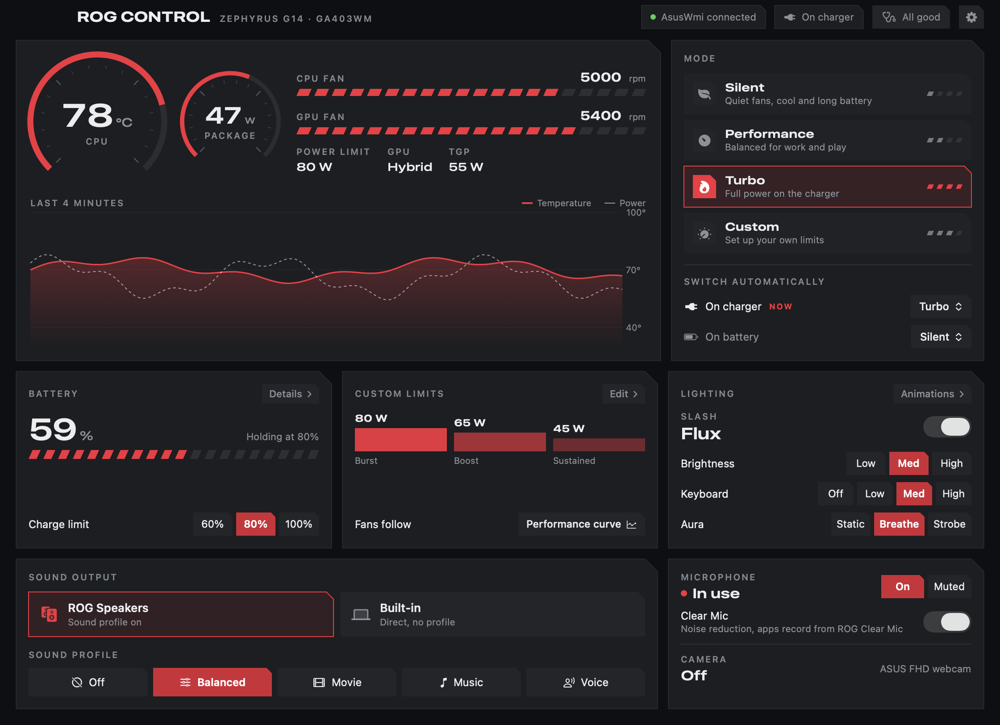</p>
<p align="center"><em>Một màn hình: số đo trực tiếp và chế độ ở trên, pin, giới hạn Custom và đèn ở dưới. Phần cài đặt mở bằng dialog.</em></p>

<p align="center">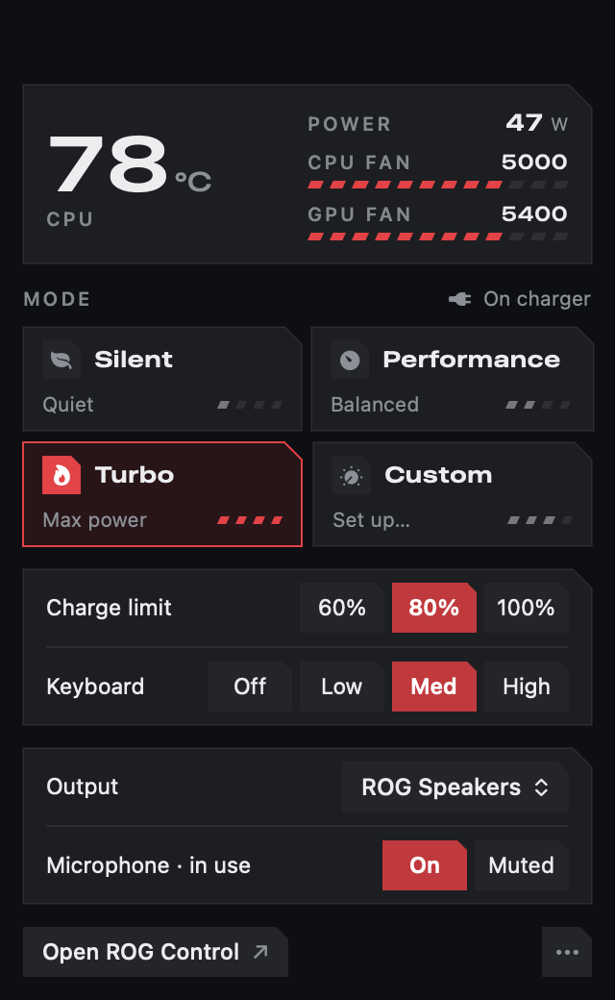</p>
<p align="center"><em>Panel trên thanh menu</em></p>

<p align="center">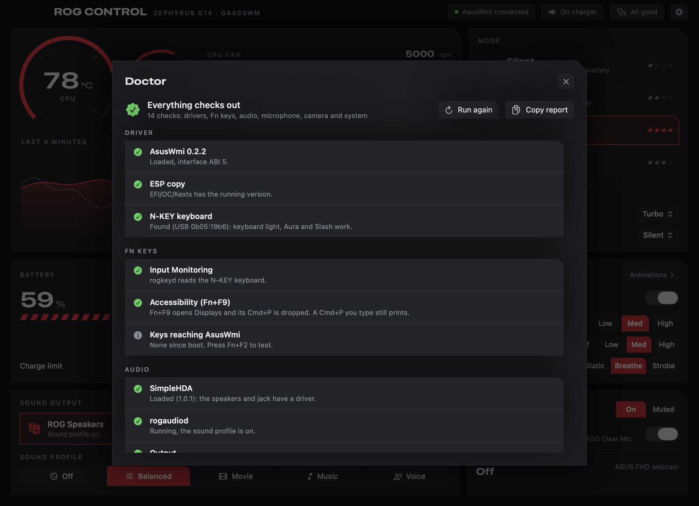&nbsp;&nbsp;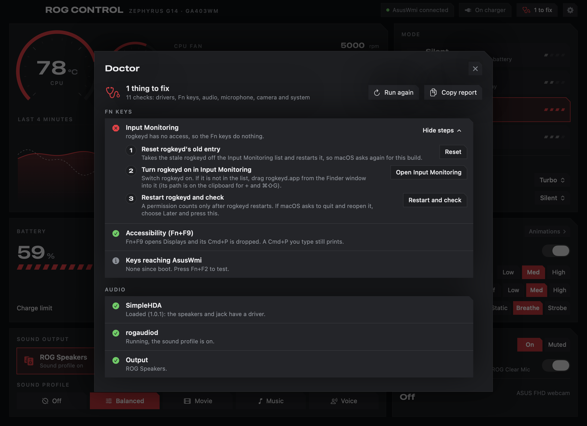</p>
<p align="center"><em>Doctor: mọi thành phần trong một danh sách, và các bước sửa khi thiếu quyền</em></p>

<p align="center">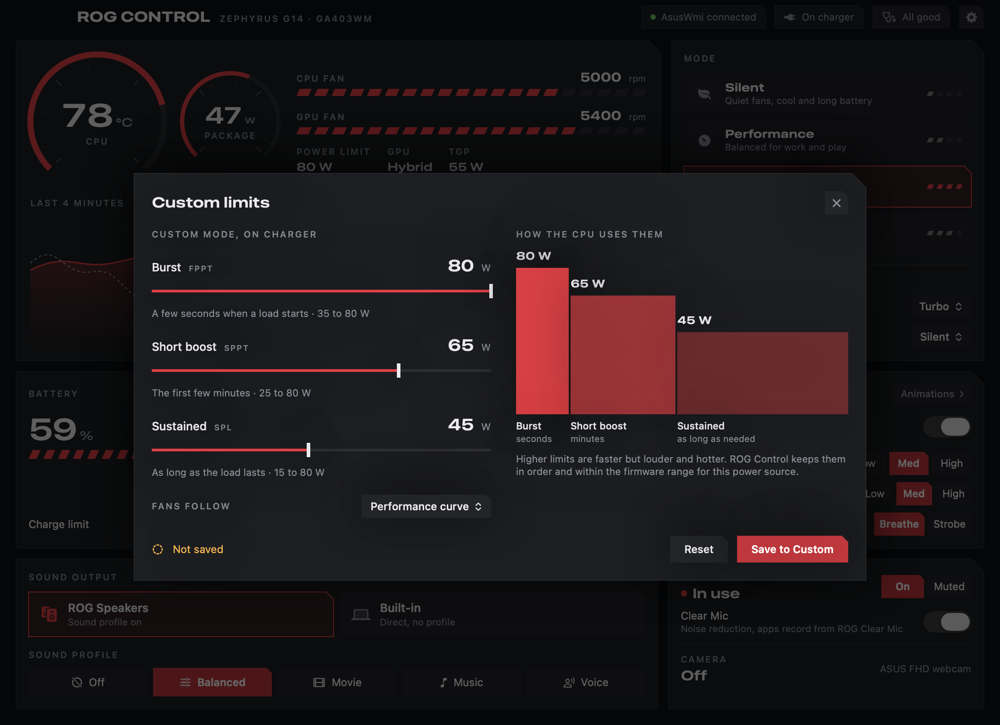&nbsp;&nbsp;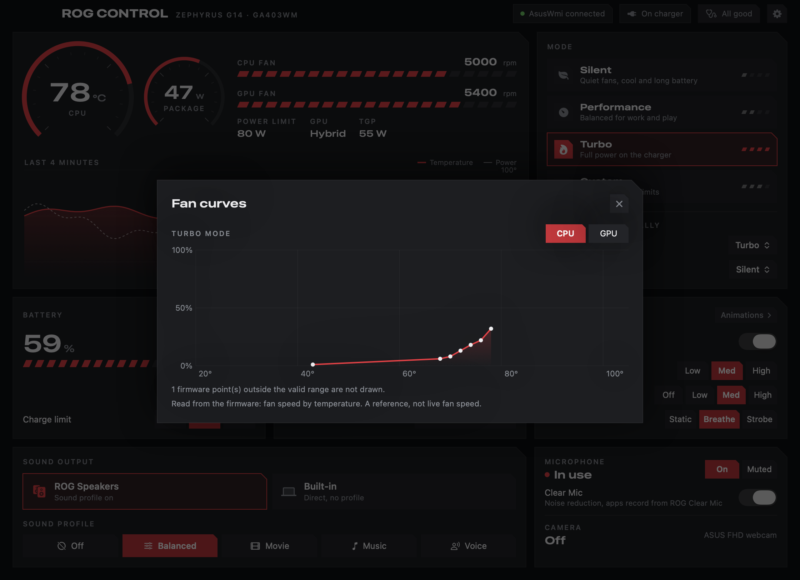</p>
<p align="center"><em>Dialog giới hạn Custom (burst, short boost, sustained bằng lời dễ hiểu) và đường cong quạt của firmware</em></p>

<p align="center">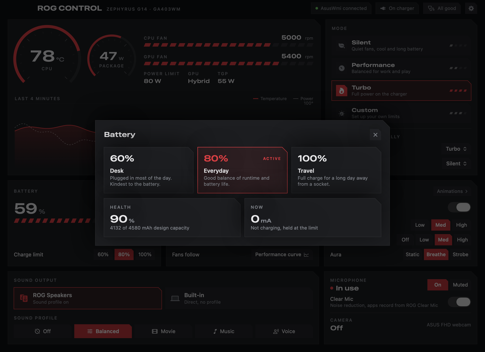&nbsp;&nbsp;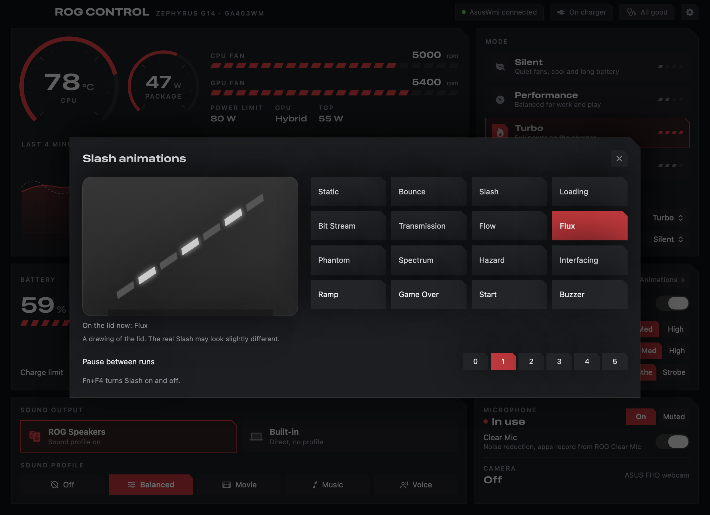</p>
<p align="center"><em>Dialog pin (mức giới hạn sạc, độ chai) và hiệu ứng Slash với mô phỏng mặt lưng G14</em></p>

<p align="center">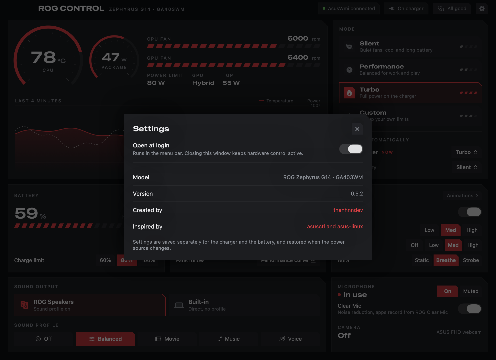&nbsp;&nbsp;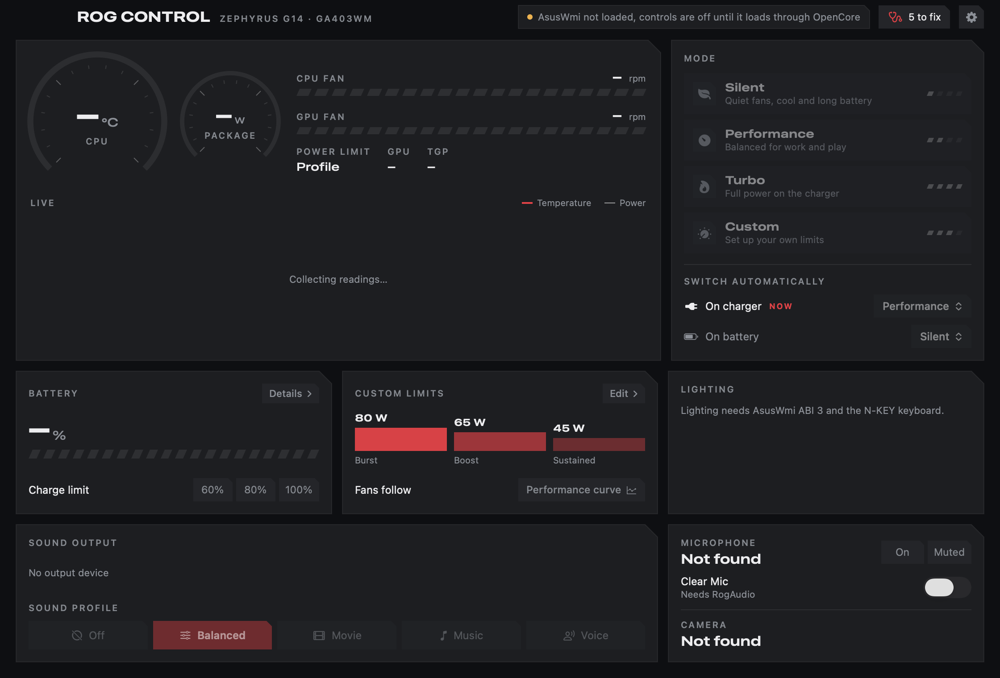</p>
<p align="center"><em>Settings, và cửa sổ khi AsusWmi chưa được nạp</em></p>

<p align="center">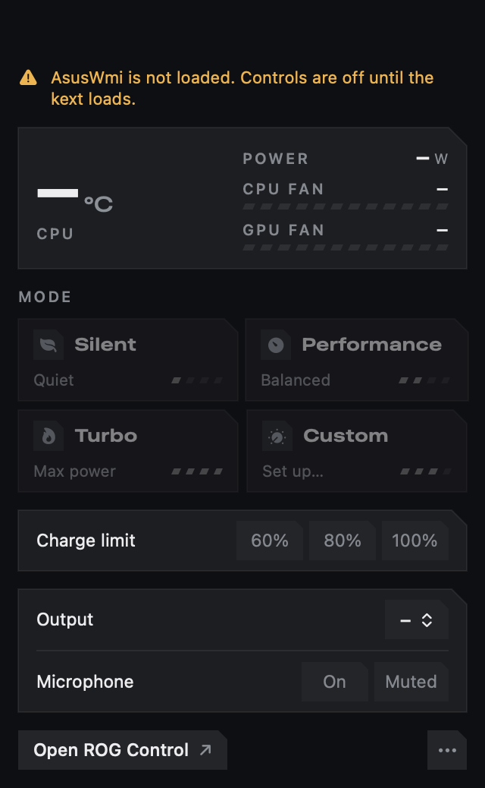</p>
<p align="center"><em>Panel khi AsusWmi chưa được nạp: tắt điều khiển, không hiện số đoán</em></p>

<p align="center">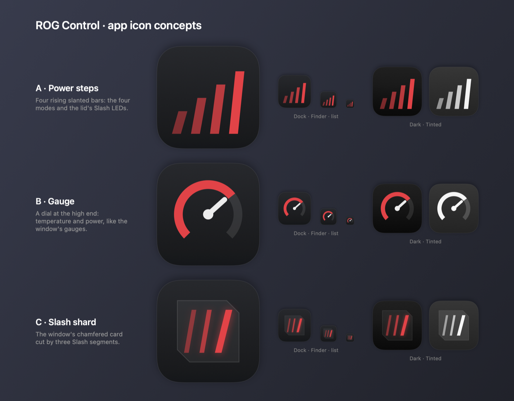</p>
<p align="center"><em>Các phương án icon; chọn C (Slash shard). Ảnh chụp là bản render offscreen với dữ liệu mẫu.</em></p>

## Release

| Release | Nội dung |
|---|---|
| [rogcontrol-v0.5.2](https://github.com/thanhnndev/rog-control-macos/releases/tag/rogcontrol-v0.5.2) | `RogControl-0.5.2.dmg`: Doctor (kiểm tra và hướng dẫn sửa), điều khiển Aura, hàng âm thanh thẳng lưới, mỗi người dùng một bản. `AsusWmi-0.2.2.kext.zip` (phím Fn, Aura, sửa panic Fn+F7/F8; ABI 5) và `rogkeyd-1.2.app.zip` (đọc phím Fn); xem [docs/FN-HOTKEYS.md](docs/FN-HOTKEYS.md) |
| [rogcontrol-v0.4.0](https://github.com/thanhnndev/rog-control-macos/releases/tag/rogcontrol-v0.4.0) | `RogControl-0.4.0.dmg`: đầu ra âm thanh, profile âm thanh, micro, Clear Mic và camera |
| [rogcontrol-v0.3.3](https://github.com/thanhnndev/rog-control-macos/releases/tag/rogcontrol-v0.3.3) | `RogControl-0.3.3.dmg`: cửa sổ một màn hình với dialog, gọn không thừa khoảng trống, icon thanh menu theo kiểu badge của app, số nhiệt độ và công suất ổn định hơn; mở DMG rồi kéo vào Applications. Kext giữ nguyên ở `rog-v1.0` |
| [rog-v1.0](https://github.com/thanhnndev/rog-control-macos/releases/tag/rog-v1.0) | `AsusWmi.kext`, `AmdCppc.kext`, `AmdCppcPolicy`, `RogControl.app`, `SHA256SUMS.txt`. Binary chép nguyên từ `kext-v1.1` của repo EFI; cùng checksum |

## Build

Trên macOS có Xcode command line tools (không build kext được trên Linux):

```bash
bash scripts/build.sh                      # build/AsusWmi.kext, build/AmdCppc.kext
bash scripts/build-amdcppc-policy.sh       # build/AmdCppcPolicy
bash scripts/test-rogcontrol.sh            # test giải mã đường cong quạt, không ghi phần cứng
bash scripts/build-rogcontrol.sh           # build/RogControl.app
bash scripts/build-rogcontrol.sh --install # chép vào /Applications, chạy khi đăng nhập
bash scripts/build-rogkeys.sh --install    # LaunchAgent rogkeyd (phím Fn); sau đó cấp Input Monitoring
bash scripts/build-dmg.sh                  # build/RogControl-<version>.dmg, kéo thả vào Applications
```

CI build tương tự trên `macos-15` và tải lên các file zip (ký ad-hoc, không notarize).

## Cài kext

OpenCore chỉ nạp những gì `config.plist` liệt kê, theo đường dẫn. Chép kext vào `EFI/OC/Kexts`, thêm vào `Kernel > Add`, khởi
động lại. `scripts/macos-install-kext.sh AsusWmi` chép giúp và giữ kext cũ trong `EFI/OC/Kexts-backup`; `--undo` trả lại. Script
không sửa `config.plist`. AmdCppc và daemon chính sách: [docs/CPU-POWER.md](docs/CPU-POWER.md).

## Tài liệu

* [docs/ASUSCTL-MACOS.md](docs/ASUSCTL-MACOS.md): bản đồ tính năng, id thiết bị WMI, ABI, số đo.
* [docs/rog-control-design.md](docs/rog-control-design.md): quyết định thiết kế thanh menu và cửa sổ, quy tắc vẽ đường cong quạt.
* [docs/CPU-POWER.md](docs/CPU-POWER.md): kiểm tra AmdCppc và chính sách CPPC.
* [docs/FN-HOTKEYS.md](docs/FN-HOTKEYS.md): bảng phím Fn, rogkeyd, và lý do không thay driver bàn phím.
* [docs/AUDIO-ROG.md](docs/AUDIO-ROG.md) (nhánh `dev/audio`).

## Nhánh

* `main`: app thanh menu đang dùng, rogkeyd và hai kext.
* `dev/fn-hotkeys`: cách làm phím Fn cũ qua ATKD WMI, vốn không bao giờ kích hoạt trên máy này. Đã được rogkeyd thay thế; không gộp.
* `dev/audio`: viết lại app từ đầu có trang âm thanh, plug-in HAL RogAudio và chuỗi mic. Lần cuối động tới nhánh này loa vẫn
  chưa nghe được trong test có người nghe. Chưa gộp.

Lịch sử các file này được tách từ `thanhnndev/ga403wm-hackintosh` bằng `git filter-repo`; commit giữ nguyên ngày và tác giả.

## Giấy phép

[Clear BSD](LICENSE). Ghi công và ghi chú bên thứ ba: [NOTICE.md](NOTICE.md).
